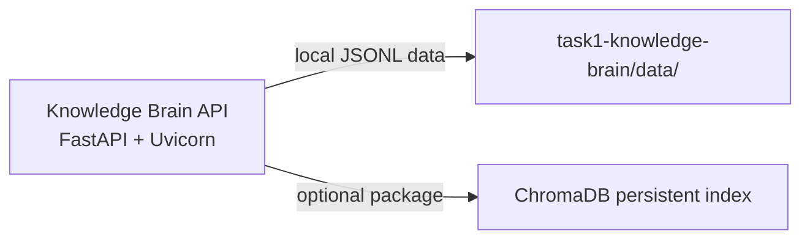

# Azure Debug Plan

> This plan is the source of truth for generating the
> VS Code debug setup in this workspace.
>
> **Status:** Implemented
> **Execution Mode:** Guided
> **Created:** 2026-10-16T10:20:32+05:30
> **Last Updated:** 2026-10-16T10:35:00+05:30
>
> Guided Mode (default) - review this plan and approve it before configuration files are generated.

## Prerequisites

| Tool / Extension                   | Category        | Service(s)      | Installed | Version |
| ---------------------------------- | --------------- | --------------- | --------- | ------- |
| Python                             | Runtime         | knowledge-brain | ✅        | 3.11.5  |
| pip                                | Package manager | knowledge-brain | ✅        | 25.3    |
| pytest                             | Test runner     | knowledge-brain | ✅        | 9.1.1   |
| No additional debug tools required | Debug tooling   | knowledge-brain | ✅        | —       |

This is an API-only Python service with no Azure Functions project, browser frontend, Azure SDK dependency, or local emulator requirement. Docker and Podman were not confirmed and are not required for this plan.

## Debug Configurations

| Generate | Debug Config Name           | Service Label       | Service Root            | Project Type | Runtime | Version | Azure Dependencies |
| -------- | --------------------------- | ------------------- | ----------------------- | ------------ | ------- | ------- | ------------------ |
| [x]      | Knowledge Brain API (debug) | Knowledge Brain API | ./task1-knowledge-brain | app-service  | python  | 3.11.5  | —                  |

Project Type Descriptions

| Project Type | Description                                              |
| ------------ | -------------------------------------------------------- |
| app-service  | HTTP server application running with Uvicorn and FastAPI |

## Orchestrator

No container orchestrator is required. The service persists local JSONL data under `task1-knowledge-brain/data/` and falls back to an in-memory retrieval index when ChromaDB is unavailable.

| Orchestrator | Container Runtime | Compose Command | Description                                                        |
| ------------ | ----------------- | --------------- | ------------------------------------------------------------------ |
| None         | —                 | —               | No emulator or dependent container is required for local debugging |

## Emulators

No Azure service emulator is required.

| Dependent Service | Emulator | Purpose |
| ----------------- | -------- | ------- |
| —                 | —        | —       |

## Architecture Diagram

VS Code launches the FastAPI application with Uvicorn; requests use the local JSONL-backed knowledge data directory and the optional ChromaDB integration when installed.

## API Test Collections

| Generate | Service             | Description                                                                                                                                                         |
| -------- | ------------------- | ------------------------------------------------------------------------------------------------------------------------------------------------------------------- |
| [x]      | Knowledge Brain API | 

HTTP Endpoints (5)
 GET /health POST /query POST /ingestion/run GET /ingestion/status POST /escalations  
 |

The generated API smoke tests should cover the health response, query validation and fallback behavior, ingestion status, and escalation creation. The ingestion trigger may be exercised with a bounded request to avoid requiring external network access.

Generated collection folders:

- `api-test-collections/knowledge-brain-api/http-health`
- `api-test-collections/knowledge-brain-api/http-query`
- `api-test-collections/knowledge-brain-api/http-ingestion-run`
- `api-test-collections/knowledge-brain-api/http-ingestion-status`
- `api-test-collections/knowledge-brain-api/http-escalations`

## Convenience Scripts

| Generate | Script    | Registered In                     | Description                                                          |
| -------- | --------- | --------------------------------- | -------------------------------------------------------------------- |
| [x]      | test      | ./pytest.ini                      | Run the deterministic evaluation suite with `pytest -q`              |
| [x]      | api:debug | ./task1-knowledge-brain/README.md | Start the FastAPI service with Uvicorn on the local development port |

## Debug Configuration Checklist

Debug Configuration Checklist:

✅ Knowledge Brain API (debug) - Uvicorn ready signal observed; `GET /health` returned HTTP 200; generated API smoke tests returned HTTP 200, 200, 200, 201, and 202.

Validation notes: `python -m pytest -q` passed all 20 tests; Python compilation passed; generated VS Code JSON parsed successfully; no compound configuration or emulator was planned; validation server was stopped and port 8000 is free.

⚠️ LIMITED SUPPORT: Project type "app-service" and runtime "python" have no matching reference files in the generator reference set. Configuration was generated as a best-effort FastAPI/Uvicorn setup.
