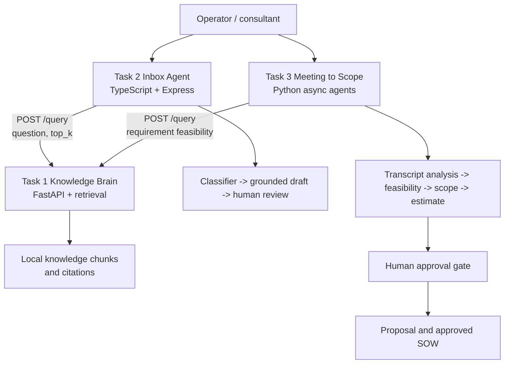

# Design

## 1. Business problem

Small businesses buy software to solve practical problems, but the economic context has changed. A capability that once required a large services team can now be delivered by a small group using cloud software and AI assistance. In the project's **90% software price-drop paradigm**, the cost of producing a first useful answer or implementation plan can fall by roughly 90% when retrieval, structured prompting, and automation are combined. The saving is not permission to remove judgment: it shifts human time toward approval, exceptions, and relationship work.

For a small business, this matters in three places. Support questions arrive before the company can afford a large support desk. Product knowledge is scattered across help content and is easy to answer inconsistently. Finally, discovery calls produce valuable requirements, but converting them into a defensible scope and estimate is slow and error-prone. AI Tech Consultant addresses those bottlenecks while keeping a human in control of financial, legal, and scope commitments.

## 2. Architecture

Task 1 owns retrieval and returns an answer, source URLs, confidence, and `needs_human`. Task 2 preserves those citations and escalates uncertain or risky emails. Task 3 asks whether each requirement is a native product setting or custom work, then attaches evidence to scope decisions. The systems communicate through REST rather than importing each other's implementation.

## 3. Four-day feature boundary

### Chosen

- Grounded Task 1 retrieval with citations and human-escalation state.
- Inbox categorization by category, urgency, and risk.
- Claude-assisted support drafting with a deterministic fallback.
- Review endpoints and a measurable 20-consecutive-approval learning rule.
- Transcript chunking, structured requirements, decisions, assumptions, feasibility checks, estimates, and proposal generation.
- Meeting A/C scope diff with Added, Modified, Removed, and Out-of-Scope labels.
- Approval gates before a scope or proposal is treated as final.
- Deterministic evaluation suites with 20 cases per task.

### Deliberately dropped

- Persistent multi-tenant accounts, authentication, and role management.
- Production queueing, background workers, and durable review-event storage.
- Automatic refunds, payment execution, or legal advice.
- Full semantic embedding search for meeting diffs; the deadline favored transparent phrase- and evidence-based rules.
- Calendar, CRM, Stripe, and deployment integrations as executable features; Meeting B documents them as scoped work rather than pretending they are delivered.
- A browser UI, analytics dashboard, and real-time collaboration.
- Automatic autonomous sending. Eligibility is recorded, but human review remains the safe default.

This boundary keeps the capstone demonstrable in four days and makes unsupported claims visible.

## 4. Model selection

Claude 3.5 Sonnet is the quality-oriented choice for nuanced transcript extraction, ambiguous scope changes, and client-ready proposal prose. Its larger reasoning budget is justified when a missed exclusion or incorrectly merged requirement could create delivery cost. Haiku is the speed-and-cost choice for repetitive inbox classification, short grounded replies, and high-volume triage. A practical deployment would route low-risk, well-known support requests to Haiku and reserve Sonnet for complex transcripts, escalations, and final proposal language.

The current implementation uses the Anthropic SDK in Task 2 and keeps the Task 3 extraction deterministic for reproducible evaluation. The model choice is therefore an operational policy, not a hidden dependency in the test suite. Model output must remain bounded by retrieved knowledge, schema validation, and approval checks.

## 5. Failure modes and guardrails

| Failure mode                                 | Guardrail                                                                                         | Residual risk                               |
| -------------------------------------------- | ------------------------------------------------------------------------------------------------- | ------------------------------------------- |
| Task 1 is offline or times out               | Client catches HTTP errors; Task 3 returns `needs_human`; Task 2 uses no fabricated product facts | A human must resolve the request            |
| Retrieval confidence is low                  | Preserve citations and escalation state; do not autonomously send                                 | A correct answer may still be escalated     |
| Refund, complaint, legal, or payment request | High-risk classification and review flags                                                         | Classification can miss novel wording       |
| AI invents a policy or price                 | Prompt says use only supplied knowledge; fallback is extractive; citations are retained           | Human fact check remains necessary          |
| Scope silently changes after discovery       | Explicit Meeting A/C diff with source quotes                                                      | Phrase-based diff needs review for synonyms |
| Feedback loop learns a bad habit             | Only low-risk, unedited approvals count; edit/reject/high-risk resets immediately                 | Twenty approvals are evidence, not proof    |
| Client assumes an external dependency exists | Scope records dependencies and exclusions                                                         | Estimates change when inputs arrive late    |

## 6. Production roadmap

**Next:** persist review events and approval identities, add authentication, add contract tests for the Task 1 API, and collect latency/token telemetry. Add a browser review queue with explicit audit history.

**Then:** use a versioned embedding index for product knowledge, semantic requirement alignment, and a human correction workflow that evaluates citations and factual support separately. Add queue retries, rate limits, secret management, and encrypted storage.

**Production:** deploy independent services with health probes and tracing, route models by risk and confidence, establish red-team tests for prompt injection and data leakage, and require legal/business owners to approve refund, contract, and compliance policies. The 20-approval rule should become one signal in a broader monitored release process, never an unobserved permission switch.
