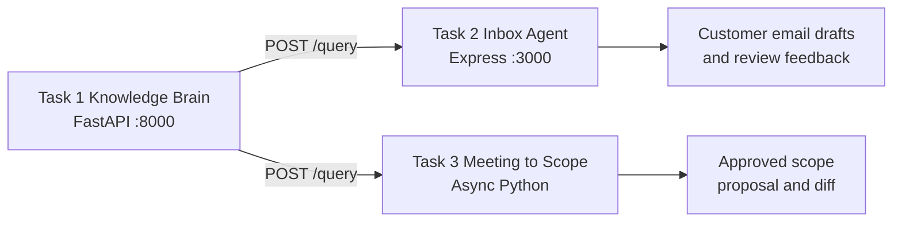

# AI Tech Consultant

AI Tech Consultant is a three-task capstone that turns product knowledge and customer conversations into grounded support replies and implementation scope. Task 1 is the shared Knowledge Brain. Task 2 uses it to classify and draft inbox replies. Task 3 uses it to turn meeting transcripts into an approved Scope of Work, estimates, and a client proposal.

## Architecture



Task 2 and Task 3 call Task 1 over HTTP; neither duplicates the knowledge index.

## Prerequisites

- Python 3.11+
- Node.js 20+
- Dependencies installed in `task1-knowledge-brain` and `task2-inbox-agent`
- `ANTHROPIC_API_KEY` for live Claude drafting. Deterministic local fallbacks keep tests runnable without the key.

## One-command run

From the project root:

- Windows: `run.bat`
- macOS/Linux: `bash ./run.sh`

The orchestrator builds Task 2, starts Task 1 on port 8000, starts Task 2 on port 3000, health-checks both services, runs all three evaluation suites, and shuts down child processes.

## Individual tests

```powershell
python -m pytest -q task1-knowledge-brain
Set-Location task2-inbox-agent; npm test
Set-Location ..\task3-meeting-to-scope; python -m pytest -q
```
